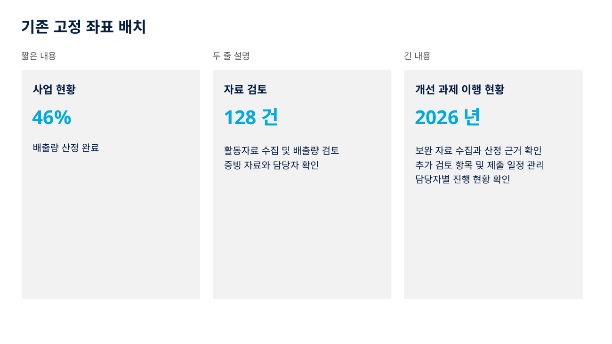
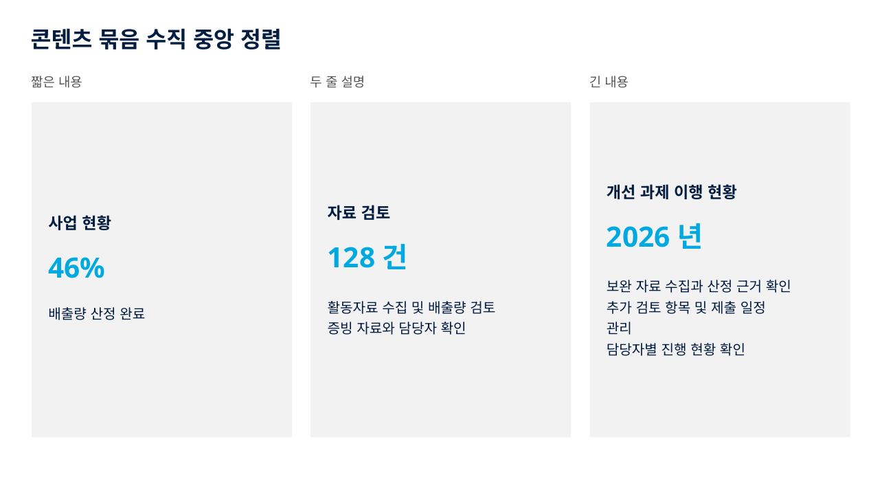
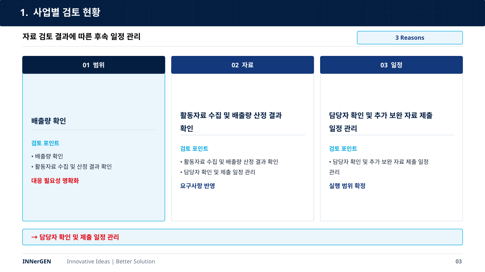

# 카드 콘텐츠 묶음의 수직 중앙 정렬

카드의 제목·숫자·설명을 개별적으로 가운데 정렬하지 않고, 줄바꿈 후의 실제 텍스트 프레임 높이와 지정 간격을 합산하여 콘텐츠 묶음 전체를 배치한다. PowerPoint 텍스트·구분선은 각각 편집 가능한 개체로 유지한다.

## 생성 경로 확인 결과

확인 기준: PR #5의 `83e30835aee9b8116c1ac987218e7876eadf9695`, 기본 브랜치 `slide-master`의 `815f3310c35b57409c96d713f36d37cef86e2f3a`.

| 경로 | 확인 내용 | 이번 변경 |
|---|---|---|
| 웹 앱(`main` 계열, PR #5에 포함) | `src/main.ts` → `buildPptxWithIterativeQa()` → `buildPptxBlob()` → `src/ppt.ts` → pptxgenjs | 일반 카드, KPI, 설명 패널에 `layoutCard()` 연결. 카드의 구분선도 묶음에 포함 |
| PR #5 채팅용 스킬 | `build_templates_v30.py` → 세 계열 JSON → `start_deck.py` → 내용 입력 SVG → `svg_to_pptx.py` → DrawingML converter | 카드의 명시적 구성원 등록, 내용 입력 후/내보내기 시 `apply_card_layout()` 실행 |
| 현재 `slide-master` | [기존 `content_balance_check.py`](https://github.com/24josh4281/Innergen-PPT/blob/815f3310c35b57409c96d713f36d37cef86e2f3a/.claude/skills/ppt-master/scripts/content_balance_check.py)의 `--fix`가 CB01 묶음을 이동. `verify_deck.py`와 채팅용 스킬 지침에도 연결됨 | 기존 도구를 유지. 이번 PR의 base에 없는 별도 경로이며 이 PR에서 해당 브랜치를 수정하지 않음 |
| 현재 `slide-master`의 사후 PPTX 처리 | [기존 `center_pptx_cards.py`](https://github.com/24josh4281/Innergen-PPT/blob/815f3310c35b57409c96d713f36d37cef86e2f3a/.claude/skills/ppt-content-group-centering/scripts/center_pptx_cards.py) 존재 | 별도 유틸리티 유지 |

따라서 저장소 전체에 관련 기능이 전혀 없었던 것은 아니다. PR #5의 `slot(valign=...)`는 개별 슬롯의 기준선만 정하며, 그 브랜치에는 위의 기존 사후 처리 도구가 포함되어 있지 않았다. 이번 변경은 PR #5 생성 경로의 공백을 보완한다. 기본 브랜치에 이미 설치된 도구를 갱신하는 PR로 해석하면 안 된다.

## 배치 규칙

- 줄바꿈 후 각 항목 높이 = 줄 수 × 글꼴 크기 × 1.5. SVG는 px, 웹은 pt를 inch로 환산.
- 묶음 높이 = 항목 높이 합계 + 항목 간 지정 간격 합계. 마지막 항목 뒤의 간격은 합산하지 않음.
- 묶음 시작점 = 컨테이너 y + (컨테이너 높이 − 묶음 높이) ÷ 2.
- 최소 상하·좌우 여백을 먼저 확보. 웹은 컨테이너별 0.24 / 0.35 / 0.34inch, SVG는 템플릿 카드별 3~8px 이상.
- 간격은 내용 길이에 따라 늘리거나 줄이지 않음. 웹의 `gapAfter`, SVG 텍스트의 `data-card-gap-after`로 서로 다른 간격도 지정 가능.
- 공백을 기준으로 자동 줄바꿈하고, 명시적 줄바꿈과 빈 줄을 유지. 짧은 숫자·라벨은 한 단위로 유지.
- 폭을 넘는 단어 또는 최소 여백을 확보할 수 없는 높이는 해당 카드·항목을 포함한 오류로 중단. 글꼴 축소나 말줄임으로 숨기지 않음.
- 웹 카드 본문은 좌측 정렬. SVG는 기존 `text-anchor`를 보존하므로 원래 좌측 정렬인 내용은 그대로 유지.
- 무표식 SVG에는 아무 변화 없음. 표·매트릭스·연결 도식의 행/열 배치는 자동 카드로 추정하지 않음.

v30 적용 카드: s65의 고객 상황·핵심 쟁점, s66의 기둥 본문·근거, s70의 핵심 근거, s72의 목표·범위·리스크, s74의 KPI·주요 가정. s65 대응 방향의 제목/모듈처럼 가로로 나란한 행과 표 셀은 기존 배치를 유지한다. 구성원을 명시하므로 배경이 겹치거나 테두리가 있다고 임의로 묶지 않는다.

## 기존 템플릿과의 호환

- 슬라이드·슬롯 ID, 토큰, 글꼴, 색상, 원래 placeholder bounds 유지.
- `data-card-slot-bounds`는 carrier 텍스트에 저장하므로 `start_deck.py`가 PPTX 메타데이터를 제거한 flat SVG에서도 가로 영역을 복원.
- 묶음과 함께 움직이는 고정 라벨은 shared Layout에서 slide-local 텍스트로 옮겨, 같은 Layout을 재사용해도 구조 계약이 내용 길이에 따라 달라지지 않도록 처리.
- 내보내기 시 카드 프레임은 별도 측정값을 사용. 변환기의 숨은 여유 폭·높이 및 `spAutoFit`이 배치를 되돌리지 않음.
- 정렬은 내용 입력 후와 내보내기 직전에 실행. PowerPoint에서 나중에 텍스트를 편집하면 저장된 정렬 위치는 유지되며, 다른 개체가 실시간으로 재배치되지는 않음. 내용 변경 후 다시 생성하거나 기존 사후 정렬 도구 사용.

## 사용 예

웹 생성기는 수정된 `buildPptxBlob()`을 그대로 호출한다. 다른 카드 생성기에서도 아래처럼 동일한 계산기를 사용할 수 있다.

```ts
layoutCard({ x: 1, y: 1, w: 3, h: 4 }, [
  { id: "title", text: "사업 현황", size: 16, gapAfter: 0.15 },
  { id: "number", text: "46%", size: 28, gapAfter: 0.2 },
  { id: "description", text: "배출량 산정 결과 확인", size: 14 }
], 0.2);
```

SVG에서는 배경 rect에 세로 순서대로 구성원 ID와 간격을 등록한다. 텍스트 또는 균일 서식 텍스트 하나를 담은 placeholder 그룹을 구성원으로 지정할 수 있다.

```xml
<rect id="card" x="20" y="30" width="320" height="260"
      data-card-members="title number description"
      data-card-gap="8" data-card-padding="12" />
```

별도 SVG 미리보기가 필요하면 원본을 보존한 사본을 만든다.

```bash
python3 claude-skills/innergen-deck/scripts/card_layout.py input.svg centered.svg
```

회전·변형 좌표와 복합 인라인 서식은 임의 추정하지 않고 오류로 알린다. 해당 경우 좌표를 확정하거나 균일 서식의 개체로 구분한 뒤 적용한다.

## 재현과 검증

```bash
npm ci
npm run build
npm run test:cards
python3 docs/innergen-v31/compare_cards.py
python3 docs/innergen-v30/build_templates_v30.py --skill claude-skills/innergen-deck --update-json
python3 docs/innergen-v30/sample_deck_v30.py --skill claude-skills/innergen-deck --out docs/generated/cards-v31/v30
```

- Python 11개 테스트: 길이 변화, 지정 간격, 빈 내용·빈 줄, 명시적 줄바꿈, 높이·단어 폭 초과, 잘못된 구성원·변형 좌표, 실패 시 원본 불변, 반복 실행, native 개체 좌표·좌측 정렬, 3계열 구조 계약, 카드 외 템플릿 불변.
- Node 회귀 검사: 실사용 `buildPptxBlob()` 경로의 카드·KPI·패널 32개 native 텍스트 프레임의 상하 여백·간격·비겹침 확인. PR #5의 원래 renderer로 같은 입력의 변경 전 PPTX도 생성.
- 웹 견본 5장: 기존 package QA 점수 100, overflow 0 / overlap 0 / ellipsis 0 / sparse-container 0.
- v30 3계열 × 10장: SVG checker ERROR 0, native PPTX 변환 30/30 성공. 기존 IBM Plex Sans KR 글꼴 경고는 유지.
- LibreOffice에서 웹 변경 전후, 2장 비교 덱, 세 계열 v30 덱을 PDF로 변환. 대표 카드·KPI 장의 렌더 결과 확인.
- 로컬 렌더는 [Noto Sans KR](https://github.com/google/fonts/tree/main/ofl/notosanskr) 대체 글꼴 사용. PowerPoint와 원래 IBM Plex Sans KR / Malgun Gothic 환경에서의 렌더는 미확인. 폭 계산은 보수적 문자 폭 추정이므로 최종 PC에서 확인 필요.
- CI는 `card-layout.yml`에 빌드·회귀 검사와 웹 변경 전후 PPTX artifact 업로드를 추가.

## 변경 전후

[편집 가능한 2장 비교 PPTX](card_alignment_comparison.pptx) · [웹 변경 전](web_before.pptx) · [웹 변경 후](web_after.pptx)

변경 전



변경 후



실제 웹 생성 결과



## PR 의존 관계

이번 작업 브랜치의 직접 부모는 PR #5의 head 커밋이다. 새 PR의 base도 #5 브랜치로 유지한다.

`#1 → #3 → #4 → #5 → 이번 PR`

기존 #2의 `slide-master` 기반 s59~s64 작업과는 별개이며 기존 PR의 base, 커밋, 병합 상태를 바꾸지 않는다. #5가 병합된 후에만 이번 PR의 base를 실제 병합 대상 브랜치로 변경하고 차이를 다시 확인한다.
